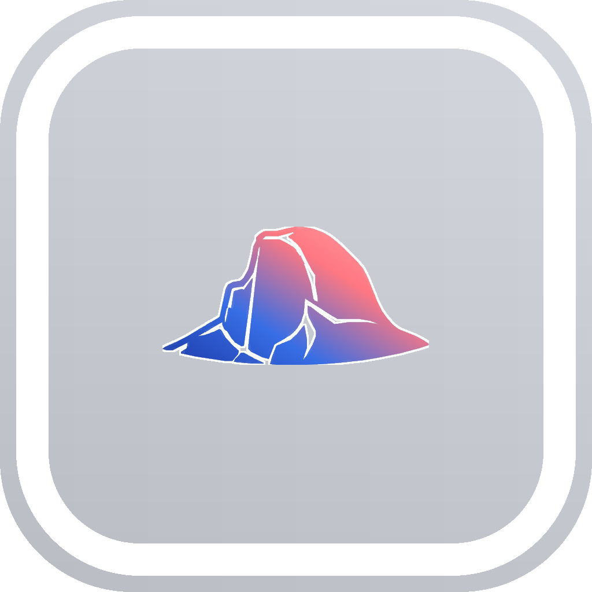

<p align="center">
  
</p>

<h1 align="center">Half Dome</h1>

<p align="center">
  An Arc-like sidebar browser on real Chromium.<br>
  Tracking fork of <a href="https://github.com/ardia-browser/ardia">Ardia</a> — their engineers carry the treadmill; we carry the experiments.
</p>

<p align="center">
  <a href="HALFDOME.md">How the fork works</a>
  ·
  <a href="halfdome/scripts/sync-ardia.sh">Sync from Ardia releases</a>
  ·
  <a href="https://github.com/ardia-browser/ardia">Upstream Ardia</a>
</p>

## What you get

Half Dome is a macOS browser with Arc’s sidebar layout and Dia’s polish, running on a real Chromium engine (not WebKit, not Electron). Sites, extensions, and DevTools behave like Chrome.

- **Spaces.** Switch between them; customise each space’s icon, name, and theme from a right-click or the space menu.
- **Address bar on the left.** Put the URL in the left sidebar (Arc-style) so the page runs edge to edge — no top toolbar.
- **Pinned tiles, tab groups, splits, PiP** and the rest of the Ardia/Dia sidebar browser.
- **Chrome Web Store extensions**, built-in uBlock Origin, and iCloud sync (end-to-end encrypted in your own Drive).

Identity is separate from Ardia (`Half Dome.app`, `app.halfdome.browser`, its own data dirs). Details: [HALFDOME.md](HALFDOME.md).

## Build for personal use

Apple Silicon Mac. Needs Xcode 26+, CocoaPods, Node 24 (`.nvmrc`), pnpm 12.

```bash
pnpm install
pnpm pods
```

Dev (Metro + Debug app; data under `~/Library/Application Support/Half Dome Dev`):

```bash
pnpm dev          # terminal 1
pnpm macos        # terminal 2
```

Ad-hoc Release for a Mac that isn’t on the team’s provisioning profile (Passkeys / keychain groups won’t work):

```bash
scripts/agent/build-app --as you --config Release --adhoc --prebuilt-engine
```

The prebuilt Chromium engine downloads on first build (~110 MB). Changing anything under `engine/` means building Chromium from source — see Upstream below.

Fork sync when Ardia ships a release:

```bash
halfdome/scripts/sync-ardia.sh v0.2.48
```

## License

As distributed, Half Dome is [GPL-3.0](LICENSE): the engine lineage carries GPL patches (same as Ardia). Source in this tree that isn’t engine-bound stays [Apache-2.0](LICENSE.Apache-2.0). Chromium, CEF patches, uBlock Origin and the rest are under their own terms — see [NOTICE](NOTICE).

---

<details>
<summary><strong>Upstream Ardia</strong> — layout, architecture, and deeper build notes</summary>

### Layout

```
apps/
  browser/            Expo + react-native-macos app (UI in src/, Xcode in macos/)
  linux/              Linux desktop UI; shares the browser components
packages/
  ardiacore/          Chromium framework + JS API
  shell/              Native menus, windows, SF Symbols
  shaders/            Metal New Tab effects + window backdrop
  import/             Import from other browsers (incl. Arc spaces)
  core/               Omnibox / suggestions (pure TS, tested)
```

### Engine and signed builds

With no local `~/chromium-build`, the app build fetches the prebuilt matching the checkout’s macOS engine key (`engine/engine-key.sh --platform macos`) and checks it against `packages/ardiacore/prebuilt-engines.tsv`. Passkeys and saved cards need the team ID and won’t work in an ad-hoc or third-party-signed build.

To change the engine: rebuild Chrome’s framework from the patched Chromium tree (`docs/engine-build.md`), then `engine/chromium/apply.sh`, `engine/ardiacore/apply.sh`, and `autoninja` as documented there. Never wipe `~/chromium-build/.../out` or run `gclient sync` / `gn clean` casually — a full rebuild is hours.

Signed DMGs and Sparkle updates come from the Release workflow (`scripts/release.sh`, `docs/releasing.md`). Linux packages and Windows alpha are separate pipelines (`docs/linux-port.md`, `docs/windows.md`).

Other tasks: `pnpm typecheck`, `pnpm test`, `pnpm shaders:check`, `scripts/agent/build-app --config Release`.

Shortcuts: ⌘T new tab, ⌘L command bar, ⌘W close, ⇧⌘T reopen, ⌘S sidebar, ⌘[ / ⌘] back/forward, ⌘R reload, ⌘1–⌘9 select tab, ⌃Tab cycle.

### Architecture notes

- **Expo SDK 54** with `react-native-macos` 0.81 (legacy architecture; Fabric still experimental on macOS).
- **Metro**, not `expo start` — `metro.config.js` redirects `react-native` → `react-native-macos` for `platform=macos`.
- **No Reanimated** on this RN macOS line; animations use RN `Animated`.
- **pnpm** uses `nodeLinker: hoisted` so CocoaPods and Metro resolve `react-native-macos` by path.
- **Shaders** are Metal source embedded in Swift and compiled at runtime (cached per class).

Feature parity with Dia (minus AI) lives in [docs/dia-feature-parity.md](docs/dia-feature-parity.md). Dia New Tab light reconstruction history: `git show f2c0e251:packages/shaders/ios/AreaLightView.swift` and the disassembly notes formerly in this README.

</details>
